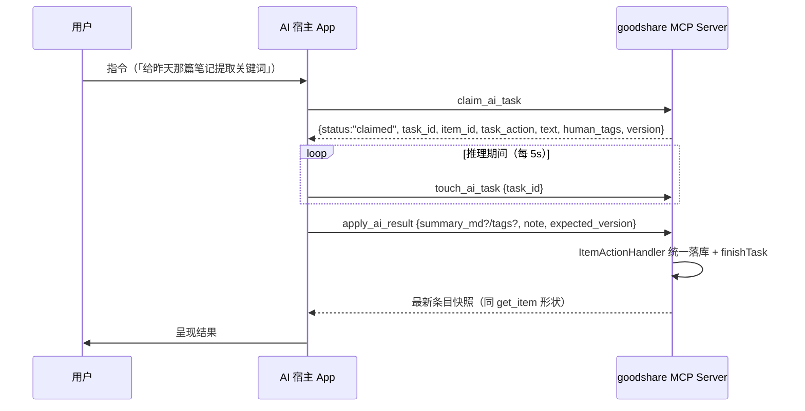

# AI 宿主 App 拆分契约（M0 接缝）

> goodshare ↔ AI 宿主 App 的分界与 MCP 接缝契约 SSOT。2026-10-10 拍板（方向四轮收敛：worker → 纯客户端 → 分治模型 → 只拆 LLM）。
> M1/M2 实施以此文为唯一接缝事实源；任何一边改动接缝须同轮修本文档。宿主 App 自身的产品设计（UI / agent / 共享区）不在本文范围——它独立成仓、自成 SSOT。

**实施状态（2026-10-15 对账）**：M1（三接缝工具 + 占位守卫）✅ d34dda5；M2.5（Tier/prompts/resources/SSE 帧流）✅；M3（resources.subscribe + sampling 反向推理 + ai_suggest_tags）✅；**M2 减法（摘 LiteRT 引擎）✅ 2026-10-14 ad06133**——本文 §5/§6 由「计划」转为「已落地」描述。**宿主闭环 ✅（2026-10-15 用户确认）**：goodhub 侧 claim/touch/apply 远程 LLM 闭环跑通（`goodshare_task_api.dart` + `task_loop_service` + BYOK 云端/Binder 节点卡均在宿主仓归并），LLM 工具族结束「入队空转」。剩余 = 按宿主使用反馈补接缝（附件通道 FileProvider 延后件、长任务 progress 中途帧）。

**即时摘要产品化（2026-10-17 拍板，instant-ai-sampling 一期）**：sampling 从「最小验证」转「产品化消费」——goodshare 侧设计稿 `docs/design/instant-ai-sampling.md`（D1 仅即时摘要 / D2 instant 配额池 60 次/60min / D3 maxTokens 维持 1024 / D4 采用/忽略确认卡落库）；接缝增量 = §3.11 消费工具扩族 + `pool` 分池字段。异管线（claim/apply）保留不动，宿主离线时长文详摘要仍走 `summarize_item`。

**任务通知接缝（2026-10-18 新增 §3.12，Notify-then-Pull）**：修复「拉模型缺拉手」断链——goodshare 入队后广播一帧 `notifications/x-goodshare/task_queued`（oneway、尽力而为），宿主收到后**自主**触发 claim；通知只是加速器，**宿主挂载/重连时的 catch-up 补拉才是正确性地基**。不改 claim/apply 语义（§3.2/§3.4 零变更）。

## 1. 角色定位（拍板）

| 角色 | 定位 |
|---|---|
| **AI 宿主 App**（独立新仓） | **master / 交互式 MCP 客户端**：自有 UI（聊天 / 决策卡片 / 向导）、自有引擎（端侧 LiteRT-LM + 云端 LLM，后续 Sherpa 等）、自有持久数据；可接入多个 MCP server，goodshare 只是其一 |
| **goodshare** | 数据事实源（SQLite + 附件沙箱）+ MCP server + 采集 / 浏览 UI；M2 后**不再持有 LLM**。轻量模型（ML Kit 全族）、端侧转写（Sherpa/ASR）、非模型任务全部留原地 |

**不是 worker**：goodshare 不派活、不知道宿主存在；认领时机、并发数、推理引擎选择（端侧 / 云端）全由宿主自主。两 app 的唯一耦合面 = 本文 §3 的三个 MCP 工具 + 既有工具面。

## 2. 分治边界（拍板：只拆 LLM）

| 任务（task_action） | 引擎 | 落点 |
|---|---|---|
| `llm_summarize` / `llm_tags` / `block_summarize` | LiteRT-LM（**同一引擎的条目两 prompt 分支 + 块分支，物理绑死，同进退**） | **宿主 App**（远程集合） |
| `ocr_and_extract` / `classify_image` / `scan_barcode` / `analyze_text` / `translate` / `block_ocr` / `block_translate` | ML Kit（bundled 毫秒级，无模型下载管理） | goodshare |
| `extract_palette` / `url_extract` / `normalize_document` | 非模型（规则 / 网络 / 本地转换） | goodshare |
| `transcribe_audio` / `block_transcribe` / `clip:*` / `block_extract_audio` | Sherpa + media3 | goodshare（本期不拆；远程化触发条件见 §7） |

远程集合 = {`llm_summarize`, `llm_tags`, `block_summarize`}，常量在 goodshare 侧单点定义（Repository），claim 过滤与占位守卫共用。

## 3. MCP 接缝契约（M1 新增三工具，纯增量）

既有前提（已取证）：MCP server 绑 `0.0.0.0:8765`、无状态逐请求 JSON-RPC（无 session 表）、写路径统一 `ItemActionHandler` + `expected_version` 乐观锁、Vault 对 MCP 物理隔离——宿主作为第二客户端与桌面 bridge 并存互不干扰，goodshare 既有工具面零改动。

### 3.1 交互时序

### 3.2 claim_ai_task

| 项 | 契约 |
|---|---|
| 参数 | 无（一次认领一条；宿主可连续调用直到 idle） |
| 行为 | 取 `ai_task_queue` 中 `status='pending'` 且 `task_action` ∈ 远程集合的最旧任务（rowid 序），原子置 `processing`（复用 `Repository.claimTask` 原语 + 远程集合过滤） |
| 返回（有任务） | `{status: "claimed", task_id, item_id, task_action, text, human_tags?, block_key?, version}`——**纯文本载荷，无附件**：条目级任务 `text` = 条目正文（`human_md ?? raw_content`，与 `ReconstructInput` 同基线）；`llm_tags` 附 `human_tags`（并集基线，D2 只增不删）；`block_summarize` 附 `block_key` 且 `text` = 块源产物文本（transcript→ocr_text 取源优先级，与 `queue_consumer` 同口径）；`version` = 认领时条目乐观锁版本 |
| 返回（无任务） | `{status: "idle"}` |
| 返回（条目不可见） | `{status: "not_found", task_id, item_id, task_action, note}`——认领原子成功后条目被删/移出 AI 可见域（乐观竞态）：任务保持 processing，宿主按 `note` 指引用 apply_ai_result 回写 failed 收尾，避免孤儿 processing 白等 30s 僵尸回收 |
| 正文不预截断 | goodshare 不截断 `text`（全文存储口径）；宿主按自身引擎 ctx（端侧 4096 / 云端更长）自行处理超限（自有降级 + note） |

### 3.3 touch_ai_task

| 项 | 契约 |
|---|---|
| 参数 | `{task_id}` |
| 行为 | 映射 `Repository.touchTask`（刷新 `updated_at`）；宿主自认领起每 5s 一次（含推理前的模型加载等待期——首测引擎加载可达分钟级） |
| 超时语义 | 30s 未心跳 → 既有 `reclaimStaleTasks` 重置 `pending`，可被再次 claim（进程被杀场景的既有兜底，零新增） |

### 3.4 apply_ai_result

| 项 | 契约 |
|---|---|
| 参数 | `{task_id, id, expected_version?, summary_md?, tags?, note?, block_key?}`（`id` = 条目 uuid，与既有工具面 `id` 参数惯例一致；2026-10-10 宿主实连核对时由草案 `item_id` 对齐实现） |
| 行为 | 内部 = `ItemActionHandler.execute(ApplyAiResultCommand(...))`——**与进程内消费者同一落库出口**（machine_json Schema / 打码 D1 / 块产物原子落库 / 乐观锁全部自动继承）；随后 `finishTask(task_id, completed/failed, note)` |
| tags 语义 | `llm_tags` 返回**合并后的完整标签列表**（宿主按 D2 做 `human_tags ∪ 新增`）；goodshare 按原样写入（与本地 LlmReconstructor 的产出形态一致） |
| 幂等与冲突 | 任务被回收重认领后再次 apply：条目写入受 `expected_version` 保护（冲突返回 `version_conflict`，宿主重读重试或放弃）；`finishTask` 对已终态任务幂等无副作用 |
| 返回 | 最新条目快照（同 `get_item` 形状，同既有写工具口径） |

### 3.5 tools/list annotations（M2-T4 增量，2026-10-11）

`toolSchemas()` 每个工具显式携带 `annotations.readOnlyHint`（MCP 标准字段，Hint 后缀 = 提示非保证），供宿主客户端 L1/L2 权限网关做**建议值**消费（goodhub 拍板 C2：hint 只作建议、客户端终裁决、与本地表冲突按更严格者、双缺从严按写处理）。

- **声明口径**：纯查询七项（`list_items` / `get_item` / `query_machine_data` / `list_workspaces` / `list_jobs` / `get_job_status` / `get_timeline_context`）声明 `true`；其余全部工具显式 `false`——包装层 `_kReadOnlyHints` 单点声明，未登记工具默认 `false`（新增写工具零动作即安全，新增只读工具须登记）。
- **守卫钉子**：`mcp_tools_test.dart` 「readOnlyHint 声明」用例——每工具显式布尔、只读七项之外一律 false。
- **自定义扩展预告**：`x-mcp-export-to-shared` 注解（F1.5 Server 角色海关过滤）沿用本字段组惯例（`x-` 前缀），随 Server 角色重启再定（goodhub architecture §8）。

### 3.6 Tier 能力协商分类（M2.5 增量，2026-10-11；M3 修订）

`initialize` 返回 capabilities 为 **`tools` + `prompts` + `resources`**（M2.5）**+ `sampling` + `resources.subscribe`**（M3，见 §3.10/§3.11）。宿主按 capabilities 有无自动降级（goodhub architecture §14）：**Tier 1 = 本契约全量**（goodshare：tools/prompts/resources/progress/sampling/subscriptions + 私有扩展 `x-mcp-export-to-shared`）；**Tier 2 = vanilla MCP**（仅 tools）——宿主 Polyfill：无 prompts → 无 Skill 注入、无 resources → 只读工具照常暴露、无 progress → 纯 Loading 态、无 sampling → 反向推理工具返回结构化 status（§3.11）、无订阅 → 不做失效感知；**降级是默认行为，不抛异常**。**Tier 判定口径不变**：Tier 1 = prompts+resources 声明齐全——sampling/subscriptions 只作宿主消费面 gate，不入判定（goodhub ServerCapabilities 语义）。

### 3.7 prompts 能力（M2.5 增量：CoW 模板源）

capabilities 声明：`'prompts': {}`。

| 项 | 契约 |
|---|---|
| `prompts/list` | `{prompts: [{name, description, arguments: [{name, description?, required?}], _meta: {template_version, min_hub_version}}]}`——模板由 goodshare **官方预置**（本仓单点维护），宿主出厂继承 CoW：拉取 → 本地沙盒覆写最高优先级 + 一键重置（goodhub architecture §3） |
| `prompts/get {name, arguments?}` | `{description?, messages: [{role: 'user', content: {type: 'text', text}}]}`——模板 `{arg}` 占位符做字面替换（单次遍历不递归）；**arguments 整体缺省 → 返回未渲染原文**（占位符保留，CoW 同步拉取原文的通道，M2.5-T6）；显式传参但 `required` 缺失 / 未知 `name` → `-32602` |
| 版本语义 | `template_version` **大版本（major）跃迁 → 宿主强制告警**（提示差异 + 用户选重置/保留）；`min_hub_version` = 消费模板所需宿主最低版本。**否决三路合并引擎**（Markdown prompt 冲突不值得合并器） |
| 内容口径 | 模板正文可引用既有工具面（get_item / list_items 等），宿主模型按工具面执行——prompts 只描述意图编排，不新增工具 |

### 3.8 resources 能力（M2.5 增量：只读数据面；M3 增 `subscribe`）

capabilities 声明：`'resources': {'subscribe': true}`（M3 起；订阅语义见 §3.10）。

| 项 | 契约 |
|---|---|
| URI scheme | `goodshare://items/{uuid}`——只读注入通道，与 tools（动词/副作用）正交；`$ref` 合流：宿主侧 `$ref:<server>:<id>` 元数据可指向本 URI（goodhub architecture §12），goodshare 无感 |
| `resources/list` | `{resources: [{uri, name, mimeType: 'text/plain'}]}`——**首版无 cursor 分页**，返回最近 200 条（`repo.list` 时间倒序）；可见性与 `get_item` 同口径（`aiVisible: true`，Vault 与已删物理不可见——Repository 保证） |
| `resources/read {uri}` | `{contents: [{uri, mimeType: 'text/plain', text}]}`——`text` = 条目正文（`human_md ?? raw_content`，**与 claim text 同基线**）；非本 scheme / 非法 uuid / 条目不存在或不可见 → `-32602` |

### 3.9 progress 通告 + SSE 帧流（M2.5 增量）

| 项 | 契约 |
|---|---|
| **触发口径（opt-in）** | `tools/call` params `_meta.progressToken`（string/number）非空 → 本次响应升级 **SSE 帧流**；**无 token → 单 JSON 响应不变**——桌面桥与既有客户端零破坏（MCP 语义：客户端不发 token，服务端不得发 progress 通知） |
| SSE 响应形态 | 响应头 `Content-Type: text/event-stream; charset=utf-8` + `Cache-Control: no-cache` + `X-Accel-Buffering: no`；帧序：① 起始 `notifications/progress` 帧 → ② 心跳 comment 帧 → ③ 终帧 result/error → 关闭连接 |
| progress 帧格式（MCP 标准） | `{jsonrpc: '2.0', method: 'notifications/progress', params: {progressToken, progress, total?, message?}}`——**M2.5 只发起始帧**（progress=0/total=1，宿主操作轨卡片进 `Running(progress)`）；工具执行中途的进度点（transcribe/ocr 等长任务）随宿主 callTool onProgress 注入通道再扩（M2.5-T7） |
| 心跳帧 | `: keep-alive` comment 行，**>5s 无业务帧时发送**（移动网络空闲 TCP 老化保活：Wi-Fi 休眠/NAT 过期）；与宿主「无更新超阈值判疑似卡死」**正交**——心跳不重置卡死计时，仅 progress 业务帧重置（goodhub C-1 拍板） |
| 错误分层 | SSE 起始**前**（参数校验失败）→ 常规 HTTP 状态码错误；SSE 起始**后**（工具执行抛错）→ 终帧 error 对象（HTTP 已 200，连接已建立） |
| 逐帧即时性 | 响应开启 `bufferOutput = false`——帧即时下发（中途帧/心跳/反向请求全靠流内即时性，缓冲滞留即功能失效） |

### 3.10 subscriptions 订阅能力（M3 增量，2026-10-11）

capabilities 声明：`'resources': {'subscribe': true}`；下行承载 = **GET /mcp SSE 长连接**（server 主动帧通道，M2.5 无此通道——progress 仅请求作用域内夹带）。

| 项 | 契约 |
|---|---|
| `resources/subscribe {uri}` | `{}`——uri = `goodshare://items`（**集合级**，任一条目变更均通知）或 `goodshare://items/{uuid}`（单条）；其余形状 `-32602` |
| `resources/unsubscribe {uri}` | `{}`——幂等（未订阅的 uri 退订不报错） |
| 变更通知 | 条目内容变更（add/update/softDelete/restore，Repository 唯一写入口统一覆盖 UI 写与 MCP 工具写）→ 经 GET SSE 连接广播 `{jsonrpc, method: 'notifications/resources/updated', params: {uri: 'goodshare://items/{uuid}'}}`——**params 恒为具体条目 URI**（集合级订阅也收具体 uri，宿主自行匹配） |
| 订阅作用域 | goodshare 延续**无会话 id**：订阅为 **server 级全局注册**，通知广播至所有在线 GET SSE 连接——单宿主场景语义等价，多宿主过度通知为已知取舍；连接断开订阅保留（宿主重连后重放 `resources/subscribe`，幂等） |
| SSE 连接口径 | 同 §3.9 响应头 + 心跳（5s comment 帧）+ `bufferOutput=false`；DELETE 仍 405；鉴权/Origin 校验与 POST 同路 |
| 宿主 Polyfill | server 未声明 subscribe → 宿主不建 GET 连接、不重放订阅（Tier 2 零破坏） |

### 3.11 sampling 反向推理能力（M3 增量，2026-10-11）

capabilities 声明：`'sampling': {}`；语义 = MCP 标准 `sampling/createMessage`（server 反向请求宿主 LLM 推理，goodhub architecture §12「轻量级 Server 反向请求宿主代跑推理」）。

| 项 | 契约 |
|---|---|
| 承载通道 | **请求作用域内夹带**：server 在带 `_meta.progressToken` 的 `tools/call` SSE 响应流内发请求帧 `{jsonrpc, id: 'srv_<n>', method: 'sampling/createMessage', params}`（id `srv_` 前缀防与客户端请求 id 相撞）；**单 JSON 响应（无 token）无承载通道**——sampling 消费工具在非流式调用下返回结构化 status 而非报错 |
| 请求 params | MCP 标准：`{messages: [{role: 'user'/'assistant', content: {type: 'text', text}}], systemPrompt?, maxTokens}`——goodshare 消费工具族：`ai_suggest_tags`（只读标签建议，M3 最小验证）+ `ai_summarize_now`（只读即时摘要预览，instant-ai-sampling 一期，2026-10-17）；均不落库不入队，落库由调用方经既有写路径完成。**`pool` 扩展字段**（Tier 1 私有约定，params 平级 String，缺省 = 默认池）：宿主据此分池记配额（见下行），Tier 2 server 不发 = 走默认池无感 |
| 回程路径 | 宿主按 id **POST 回端点** `{jsonrpc, id: 'srv_<n>', result: {role: 'assistant', model, content: {type: 'text', text}}}` 或 `{..., error: {code, message, data?}}`；server 按 id 唤醒等待中的工具调用，超时（90s）视为宿主不可达 |
| 配额（宿主侧 enforce，goodhub D3 拍板；2026-10-17 分池扩展） | per-server **滑动窗口次数制**，按 `pool` 分池（配额 key = `serverKey` / `serverKey:pool`）：**默认池 20 次/60min**（防滥用定位）+ **instant 池 60 次/60min**（即时交互型工具，D2 拍板）；均内存态不落盘（重启清零，定位防滥用非计费）+ 单次输出 maxTokens 宿主硬顶 clamp（1024，D3 拍板维持）；超限宿主回 error `-32000`（data.hint 带 retry after）——server 侧透传，消费工具降级为 `status: sampling_quota_exceeded` |
| 错误语义 | 宿主未启用 → `-32601`；参数违规 → `-32602`；配额 → `-32000`；宿主推理失败/回程超时 → `-32603`/`-32003`。**消费工具侧一律不 isError**（环境态不计宿主熔断，模型可改走异步管线） |
| 隔离与围栏（宿主侧） | 临时会话语义（goodhub architecture §15）：推理仅用请求自带消息，无记忆沙盒注入、无 UI 轨迹；N7 出站围栏经云引擎装饰器单咽喉自然覆盖 |
| 宿主 Polyfill | server 未声明 sampling → 宿主不强制流式、不开消费 handler（Tier 2 零破坏）；宿主未启用 handler → server 请求收到 `-32601`，不悬挂 |

### 3.12 任务通知接缝 · Notify-then-Pull（2026-10-18 新增）

> 背景：§3.2 是**拉模型**（goodshare 不推、宿主主动 claim）。宿主侧「拉手」（ClaimLoopPage）归档后无接管者 → 任务永久滞留 `pending`。本节加一条**极轻的入队通知**，把「下次启动才处理」压到毫秒级，但**不改变拉模型的权力结构**。

#### 3.12.1 通知形状与投递

| 项 | 契约 |
|---|---|
| 通知名 | `notifications/x-goodshare/task_queued`（Tier 1 私有扩展，与 `notifications/resources/updated` 同命名风格） |
| params | 空或 `{count?: int}`——**仅提示「可能有任务」，不得作为任务数量依据** |
| 承载通道 | Binder `IMcpCallback.onEvent`（oneway 单向回调，既有通道）；HTTP 走 GET SSE 订阅流（§3.10 同路） |
| 触发时机 | 任务落库提交**之后**（先持久化 PENDING、后发通知——防「通知已发但事务未提交」的空拉） |
| 投递语义 | **尽力而为（best-effort）**：oneway 无应答、无重试、可丢失、可重复、可乱序。server 不假设有宿主在听，不等结果 |

#### 3.12.2 宿主侧消费纪律（goodhub 侧实现约束，契约保证两端对齐）

1. **幂等自洽**：收到通知后必须自己 `claim_ai_task` 到 `idle` 为止，**不得按通知数量推断任务数**（N 帧通知 ≠ N 个任务，也不得只 claim 一次）
2. **自主时机（§1 原则不破）**：宿主可暂缓/延后/批量消费——前台对话进行中、低电量、通道降级时可挂起，事后补拉。**goodshare 不得因「发了通知」就认为任务会被处理**：任务终态仍由 §3.4 apply 决定，UI 维持「等待宿主处理」语义不变
3. **catch-up 是地基**：宿主**挂载/重连时必须主动 claim 到 idle 一次**——通知丢失（宿主未启动/进程被杀/通道瞬断）不导致任务永久滞留。通知只优化延迟，不承担正确性
4. **单飞 + dirty**：消费循环单运行态互斥，执行期间到达的通知置 dirty 标记、本轮结束后补跑一轮（防并发 claim 重复认领）；**单轮上限达顶不等于队列空**——须继续下一轮
5. **空拉终止**：`claim_ai_task` 返回 `idle` 即终止本轮（防空转自激）；`not_found` 是有效任务（按 §3.2 指引用 apply 回写 failed 收尾），**不算空拉**
6. **毒丸防护（必做）**：推理失败须**主动** `apply_ai_result` 回写 failed 终态（带 note），不得留 `processing` 等 30s 僵尸回收——否则该任务被 `reclaimStaleTasks` 重置 `pending` 后反复认领 = 无限重试烧额度。**这是既有实现的缺口，随本接缝一并修**
7. **生命周期解绑**：连接断开/卸载/重扫时清定时器并复位状态机；触发前确认通道在线（`ConnectionHealth` online）——严禁向已断 Binder 抛未捕获 IPC 异常
8. **熔断**：单轮连续多次推理异常 → 暂停本轮后续处理，不无限重试

#### 3.12.3 宿主不可达：呈现与一键唤醒（Actionable Pending，2026-10-18 形态 B）

> 场景：宿主未启动 / 进程被杀 / 通知丢失 / 宿主启动中。此时通知必然投递失败，任务回落为「无人消费」——形态 B 给出可见、可操作的出口，把「死等」变成「一键闭环」。

| 项 | 契约 |
|---|---|
| **任务状态** | DB **维持 `pending` 不变，不引入 WAITING_HOST 状态值**——理由：① §1「goodshare 不派活、不知道宿主存在」，服务端不记依赖宿主知识的态；② 避免 schema 迁移与 `claimRemoteTask`/占位守卫/`reclaimStaleTasks` 多处 SQL 兼容。**WAITING_HOST 是 UI 展示态，不是存储态** |
| **呈现两级** | ① pending 即显示「等待处理」；② **持续 pending 超阈值（建议 10s）仍未被认领 → 升级为可操作徽标**「等待 Goodhub 启动」（灰底，替换无意义 spinner）。**判据用时间阈值而非通道探测**——一次覆盖「通知丢失 / 宿主启动中 / 宿主崩溃 / 通道瞬断」四类，服务端零状态可维护 |
| **一键唤醒** | 徽标/详情页点击 → 弹窗 + 【启动 Goodhub】→ `packageManager.getLaunchIntentForPackage("com.zzh.goodhub")` + `FLAG_ACTIVITY_NEW_TASK` 直达；未安装 → 提示「未检测到 Goodhub 安装包」 |
| **包可见性前置（必须补）** | Android 11+ 包可见性：现 `<queries>` 仅 `<intent>` 形式（PROCESS_TEXT / MCP_SERVER action），**缺 `<package android:name="com.zzh.goodhub"/>`** → `getLaunchIntentForPackage` 恒返回 null（已装也走兜底）。本接缝落地须同轮补该声明 |
| **闭环** | 唤起 → goodhub 冷启动 → 本地插件发现 + Binder 挂载 → 触发 §3.12.2-3 的 **catch-up 冷启动自拉取** → 任务被认领处理。**宿主侧零新增**：catch-up 已覆盖，不需为「被唤起」写专门分支 |
| **跨仓常量** | goodhub 包名 `com.zzh.goodhub`（与 Binder 发现、MCP_SERVER 权限同常量族）；若将来包名变更，两端同轮改 |

#### 3.12.4 兼容与降级

- **无通知能力 = 零影响**：不发通知 / 宿主不支持 → 退化为纯拉模型（catch-up 兜底），与本节之前行为完全一致
- 与 sampling（§3.11）**通道共存**：两者共用 `onEvent`，靠「有无 id」路由（反向请求有 id+method，通知无 id）——`BinderTransport` 已实现该路由，零冲突
- §3.2 / §3.3 / §3.4 语义**零变更**（claim/touch/apply 参数、返回、幂等、乐观锁全部不变）

## 4. 占位守卫（M2 验收第一条）

M2 摘除 `LlmReconstructor` 后，`ReconstructorRegistry` 兜底的 `PlaceholderReconstructor` `handles` 恒真——若不守卫，进程内 `QueueConsumer` 会先把远程任务「占位完成」（note「未执行 AI 重构」），**宿主永远 claim 不到**。

守卫口径：`QueueConsumer` 的 pending 查询**在 SQL 层排除远程集合**（一处 WHERE 过滤，零轮询开销）——远程任务只可能被 `claim_ai_task` 认领。落地时机 M1 或 M2 均可（加法先行亦可）；验收钉子：入队 `llm_summarize` → 等 10s → 任务仍 `pending`（未被占位吞）。

## 5. goodshare 侧行为变化（M2 逐条）

| # | 变化 | 口径 |
|---|---|---|
| 1 | 摘 LiteRT 全套 | gradle `litertlm-android` 依赖、`LlmBridge.kt`、proguard keep（随迁）、`lib/ai/llm*.dart`（llm / llm_model / llm_model_manager / llm_download_isolate / llm_reconstructor）、设置页模型管理区、main 装配 |
| 2 | R1 URL 串联摘要 | `summarizeHead` 注入点改 null → 走既有「模型不在位静默跳过」路径：URL 摄入正文照常落库、无自动摘要；用户经宿主 App 手动触发摘要。零新逻辑（现成降级语义） |
| 3 | clip s 步（摘要步） | e/t 步（提音轨 / 转写）照常；s 步降级 note「摘要未生成：端侧大模型已迁出 AI 宿主 App，可在宿主中对本切片文本补摘要」——不砍步骤（降级可观测口径） |
| 4 | UI 双轨 | 「摘要 / 提取关键词」按钮照常入队（`summarize_item` / `extract_tags` MCP 工具语义不变）+ toast「已标记，打开 AI 宿主 App 处理」；宿主未安装时任务安全滞留 `pending`（不进 `processing`，僵尸回收不碰），详情页对 pending 的 LLM 任务显示等待文案 |
| 5 | 孤儿模型文件 | M2 删除下载管理入口；用户已下载的模型文件（~1.5GB）成孤儿——不强制清理（不阻塞、已知残留，后续自更新清理入口再议） |
| 6 | 包体收益 | APK 减 LiteRT 运行时（模型本为下载件不在 APK 内——收益 = 运行时库 + JNI 崩溃面移除，非 1.5GB）；「模型未下载」误报类 R8/JNI 问题在 goodshare 侧物理归零 |

## 6. 宿主 App 引擎搬迁清单（M2 随迁，非新写）

- `LlmBridge.kt`（LiteRT-LM 真推理）+ **proguard keep `-keep class com.google.ai.edge.** { *; }`**（R8 混淆致 JNI FindMethod mid==null → SIGABRT 教训，随代码带过去）
- `llm_model.dart`（SoC 感知模型目录 + NPU 专包可见性判定）、`LlmModelManager`（下载 / 暂停续传 / isolate）、模型远端 manifest（last-good 缓存）机制
- 迁移后 `docs/design/on-device-llm.md` 随迁宿主仓（本仓按 docs-spec §4 墓碑指向）；`ai-capabilities-overview.md` 同步 LLM 行口径

## 7. 附件读取通道（延后接缝，M1/M2 不实施）

LLM 任务输入纯文本 → 接缝零附件。后续 ASR 等重任务远程化的触发条件：宿主 App 具备稳定的附件读取能力后重开。届时口径：`get_item` 媒体元数据增 `content_uri`（FileProvider 对新 app 只读授权，`content://com.zzh.goodshare.files/...`），宿主经 `ContentResolver.openFileDescriptor(uri, "r")` 直读底层句柄（零内存拷贝、不过网、无暴露面）；小文件维持既有 base64 内联。

## 8. 安全口径（拍板）

- 同令牌：`claim_ai_task` 对任意持令牌者可见（含桌面 bridge）。令牌语义已是全量读写，不建第二鉴权层（YAGNI）；文档注明 claim 系列为宿主 App 主用工具。
- 乐观锁照旧：宿主与用户 / 桌面客户端并发写同一条目时 `version_conflict` 明确拒绝，不静默覆盖（human-ai 对称不破）。
- Vault 隔离照旧：宿主经 MCP 读不到 Vault 条目，物理边界不变。

## 9. 里程碑与验收

| 里程碑 | 内容 | 验收 |
|---|---|---|
| **M0 契约**（本文档） | 接缝 SSOT 落盘 | 本文档 + epic 绑定 + 索引同步 |
| **M1 PoC**（加法先行，goodshare 零破坏） | goodshare 加三工具（+测试组）；宿主 App 最小壳（MCP 连接 → claim → 推理 → apply） | 真机闭环：`llm_summarize` + `llm_tags` + `block_summarize` 各一条经宿主处理落库，`get_item` 可验证；goodshare 回归全量测试绿 + ML Kit / ASR 真机冒烟 |
| **M2 剥离**（减法，M1 验证后） | §5 六条 + §6 搬迁 + 占位守卫 | §4 守卫钉子绿；APK 无 litertlm 构建绿；analyze 0 / 全量测试绿（LLM 测试组改写为降级钉子）；UI 双轨真机验证 |
| **M3+ 宿主产品化**（独立仓，不占本 epic） | 聊天 / 决策卡片 / 多 server 连接池 / 云端 LLM / 共享区 | 宿主仓自管 |
| **M4 消费闭环**（2026-10-18 新增，跨仓） | §3.12 任务通知接缝：goodshare 入队后广播 `task_queued`；goodhub 侧接管消费循环（catch-up + 单飞 dirty + 让路 + 空拉终止 + 毒丸 failed 收尾 + 生命周期解绑）；§3.12.3 形态 B：宿主不可达时呈现「等待 Goodhub 启动」徽标 + 一键 Intent 唤起（含 `<queries>` 补 `<package>` 声明） | ① goodshare 入队 → 数秒内宿主开始 claim（通知到达可观测）；② 宿主**未启动**时启动后 catch-up 补拉，任务不永久滞留；③ 批量入队 5+ 条：单飞不并发、全数消化；④ 毒丸任务：失败回写 failed 终态，不反复认领；⑤ 断开 Binder 后触发无未捕获 IPC 异常；⑥ 宿主未启动：徽标显示「等待 Goodhub 启动」+【启动 Goodhub】直达唤起 → 回 goodshare 见任务被消化（**须先补 queries package，否则 Android 11+ 恒走未安装兜底**） |

> 顺序纪律：M1 加法先验证闭环，M2 减法才动——顺序不可反（摘了引擎无承接 = goodshare AI 功能裸奔）。
>
> M4 消费闭环的**落地顺序**：goodhub 侧消费循环（含 catch-up 与毒丸修复）**先行并独立可验收**——它不依赖通知即可工作（纯拉 + 挂载补拉）；goodshare 侧通知随后叠加，只优化延迟。若只发通知不修宿主消费循环，任务依旧不动（拉模型缺拉手的根因不因通知而消失）。
