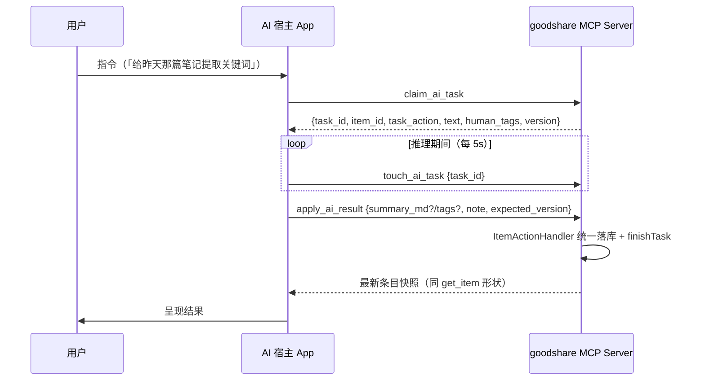

# AI 宿主 App 拆分契约（M0 接缝）

> goodshare ↔ AI 宿主 App 的分界与 MCP 接缝契约 SSOT。2026-10-10 拍板（方向四轮收敛：worker → 纯客户端 → 分治模型 → 只拆 LLM）。
> M1/M2 实施以此文为唯一接缝事实源；任何一边改动接缝须同轮修本文档。宿主 App 自身的产品设计（UI / agent / 共享区）不在本文范围——它独立成仓、自成 SSOT。

## 1. 角色定位（拍板）

| 角色 | 定位 |
|---|---|
| **AI 宿主 App**（独立新仓） | **master / 交互式 MCP 客户端**：自有 UI（聊天 / 决策卡片 / 向导）、自有引擎（端侧 LiteRT-LM + 云端 LLM，后续 Sherpa 等）、自有持久数据；可接入多个 MCP server，goodshare 只是其一 |
| **goodshare** | 数据事实源（SQLite + 附件沙箱）+ MCP server + 采集 / 浏览 UI；M2 后**不再持有 LLM**。轻量模型（ML Kit 全族）、端侧转写（Sherpa/ASR）、非模型任务全部留原地 |

**不是 worker**：goodshare 不派活、不知道宿主存在；认领时机、并发数、推理引擎选择（端侧 / 云端）全由宿主自主。两 app 的唯一耦合面 = 本文 §3 的三个 MCP 工具 + 既有工具面。

## 2. 分治边界（拍板：只拆 LLM）

| 任务（task_action） | 引擎 | 落点 |
|---|---|---|
| `llm_summarize` / `llm_tags` / `block_summarize` | LiteRT-LM（**同一引擎的条目两 prompt 分支 + 块分支，物理绑死，同进退**） | **宿主 App**（远程集合） |
| `ocr_and_extract` / `classify_image` / `scan_barcode` / `analyze_text` / `translate` / `block_ocr` / `block_translate` | ML Kit（bundled 毫秒级，无模型下载管理） | goodshare |
| `extract_palette` / `url_extract` / `normalize_document` | 非模型（规则 / 网络 / 本地转换） | goodshare |
| `transcribe_audio` / `block_transcribe` / `clip:*` / `block_extract_audio` | Sherpa + media3 | goodshare（本期不拆；远程化触发条件见 §7） |

远程集合 = {`llm_summarize`, `llm_tags`, `block_summarize`}，常量在 goodshare 侧单点定义（Repository），claim 过滤与占位守卫共用。

## 3. MCP 接缝契约（M1 新增三工具，纯增量）

既有前提（已取证）：MCP server 绑 `0.0.0.0:8765`、无状态逐请求 JSON-RPC（无 session 表）、写路径统一 `ItemActionHandler` + `expected_version` 乐观锁、Vault 对 MCP 物理隔离——宿主作为第二客户端与桌面 bridge 并存互不干扰，goodshare 既有工具面零改动。

### 3.1 交互时序

### 3.2 claim_ai_task

| 项 | 契约 |
|---|---|
| 参数 | 无（一次认领一条；宿主可连续调用直到 idle） |
| 行为 | 取 `ai_task_queue` 中 `status='pending'` 且 `task_action` ∈ 远程集合的最旧任务（rowid 序），原子置 `processing`（复用 `Repository.claimTask` 原语 + 远程集合过滤） |
| 返回（有任务） | `{task_id, item_id, task_action, text, human_tags?, block_key?, version}`——**纯文本载荷，无附件**：条目级任务 `text` = 条目正文（`human_md ?? raw_content`，与 `ReconstructInput` 同基线）；`llm_tags` 附 `human_tags`（并集基线，D2 只增不删）；`block_summarize` 附 `block_key` 且 `text` = 块源产物文本（transcript→ocr_text 取源优先级，与 `queue_consumer` 同口径）；`version` = 认领时条目乐观锁版本 |
| 返回（无任务） | `{status: "idle"}` |
| 正文不预截断 | goodshare 不截断 `text`（全文存储口径）；宿主按自身引擎 ctx（端侧 4096 / 云端更长）自行处理超限（自有降级 + note） |

### 3.3 touch_ai_task

| 项 | 契约 |
|---|---|
| 参数 | `{task_id}` |
| 行为 | 映射 `Repository.touchTask`（刷新 `updated_at`）；宿主自认领起每 5s 一次（含推理前的模型加载等待期——首测引擎加载可达分钟级） |
| 超时语义 | 30s 未心跳 → 既有 `reclaimStaleTasks` 重置 `pending`，可被再次 claim（进程被杀场景的既有兜底，零新增） |

### 3.4 apply_ai_result

| 项 | 契约 |
|---|---|
| 参数 | `{task_id, item_id, expected_version?, summary_md?, tags?, note?, block_key?}` |
| 行为 | 内部 = `ItemActionHandler.execute(ApplyAiResultCommand(...))`——**与进程内消费者同一落库出口**（machine_json Schema / 打码 D1 / 块产物原子落库 / 乐观锁全部自动继承）；随后 `finishTask(task_id, completed/failed, note)` |
| tags 语义 | `llm_tags` 返回**合并后的完整标签列表**（宿主按 D2 做 `human_tags ∪ 新增`）；goodshare 按原样写入（与本地 LlmReconstructor 的产出形态一致） |
| 幂等与冲突 | 任务被回收重认领后再次 apply：条目写入受 `expected_version` 保护（冲突返回 `version_conflict`，宿主重读重试或放弃）；`finishTask` 对已终态任务幂等无副作用 |
| 返回 | 最新条目快照（同 `get_item` 形状，同既有写工具口径） |

## 4. 占位守卫（M2 验收第一条）

M2 摘除 `LlmReconstructor` 后，`ReconstructorRegistry` 兜底的 `PlaceholderReconstructor` `handles` 恒真——若不守卫，进程内 `QueueConsumer` 会先把远程任务「占位完成」（note「未执行 AI 重构」），**宿主永远 claim 不到**。

守卫口径：`QueueConsumer` 的 pending 查询**在 SQL 层排除远程集合**（一处 WHERE 过滤，零轮询开销）——远程任务只可能被 `claim_ai_task` 认领。落地时机 M1 或 M2 均可（加法先行亦可）；验收钉子：入队 `llm_summarize` → 等 10s → 任务仍 `pending`（未被占位吞）。

## 5. goodshare 侧行为变化（M2 逐条）

| # | 变化 | 口径 |
|---|---|---|
| 1 | 摘 LiteRT 全套 | gradle `litertlm-android` 依赖、`LlmBridge.kt`、proguard keep（随迁）、`lib/ai/llm*.dart`（llm / llm_model / llm_model_manager / llm_download_isolate / llm_reconstructor）、设置页模型管理区、main 装配 |
| 2 | R1 URL 串联摘要 | `summarizeHead` 注入点改 null → 走既有「模型不在位静默跳过」路径：URL 摄入正文照常落库、无自动摘要；用户经宿主 App 手动触发摘要。零新逻辑（现成降级语义） |
| 3 | clip s 步（摘要步） | e/t 步（提音轨 / 转写）照常；s 步降级 note「摘要未生成：端侧大模型已迁出 AI 宿主 App，可在宿主中对本切片文本补摘要」——不砍步骤（降级可观测口径） |
| 4 | UI 双轨 | 「摘要 / 提取关键词」按钮照常入队（`summarize_item` / `extract_tags` MCP 工具语义不变）+ toast「已标记，打开 AI 宿主 App 处理」；宿主未安装时任务安全滞留 `pending`（不进 `processing`，僵尸回收不碰），详情页对 pending 的 LLM 任务显示等待文案 |
| 5 | 孤儿模型文件 | M2 删除下载管理入口；用户已下载的模型文件（~1.5GB）成孤儿——不强制清理（不阻塞、已知残留，后续自更新清理入口再议） |
| 6 | 包体收益 | APK 减 LiteRT 运行时（模型本为下载件不在 APK 内——收益 = 运行时库 + JNI 崩溃面移除，非 1.5GB）；「模型未下载」误报类 R8/JNI 问题在 goodshare 侧物理归零 |

## 6. 宿主 App 引擎搬迁清单（M2 随迁，非新写）

- `LlmBridge.kt`（LiteRT-LM 真推理）+ **proguard keep `-keep class com.google.ai.edge.** { *; }`**（R8 混淆致 JNI FindMethod mid==null → SIGABRT 教训，随代码带过去）
- `llm_model.dart`（SoC 感知模型目录 + NPU 专包可见性判定）、`LlmModelManager`（下载 / 暂停续传 / isolate）、模型远端 manifest（last-good 缓存）机制
- 迁移后 `docs/design/on-device-llm.md` 随迁宿主仓（本仓按 docs-spec §4 墓碑指向）；`ai-capabilities-overview.md` 同步 LLM 行口径

## 7. 附件读取通道（延后接缝，M1/M2 不实施）

LLM 任务输入纯文本 → 接缝零附件。后续 ASR 等重任务远程化的触发条件：宿主 App 具备稳定的附件读取能力后重开。届时口径：`get_item` 媒体元数据增 `content_uri`（FileProvider 对新 app 只读授权，`content://com.zzh.goodshare.files/...`），宿主经 `ContentResolver.openFileDescriptor(uri, "r")` 直读底层句柄（零内存拷贝、不过网、无暴露面）；小文件维持既有 base64 内联。

## 8. 安全口径（拍板）

- 同令牌：`claim_ai_task` 对任意持令牌者可见（含桌面 bridge）。令牌语义已是全量读写，不建第二鉴权层（YAGNI）；文档注明 claim 系列为宿主 App 主用工具。
- 乐观锁照旧：宿主与用户 / 桌面客户端并发写同一条目时 `version_conflict` 明确拒绝，不静默覆盖（human-ai 对称不破）。
- Vault 隔离照旧：宿主经 MCP 读不到 Vault 条目，物理边界不变。

## 9. 里程碑与验收

| 里程碑 | 内容 | 验收 |
|---|---|---|
| **M0 契约**（本文档） | 接缝 SSOT 落盘 | 本文档 + epic 绑定 + 索引同步 |
| **M1 PoC**（加法先行，goodshare 零破坏） | goodshare 加三工具（+测试组）；宿主 App 最小壳（MCP 连接 → claim → 推理 → apply） | 真机闭环：`llm_summarize` + `llm_tags` + `block_summarize` 各一条经宿主处理落库，`get_item` 可验证；goodshare 回归全量测试绿 + ML Kit / ASR 真机冒烟 |
| **M2 剥离**（减法，M1 验证后） | §5 六条 + §6 搬迁 + 占位守卫 | §4 守卫钉子绿；APK 无 litertlm 构建绿；analyze 0 / 全量测试绿（LLM 测试组改写为降级钉子）；UI 双轨真机验证 |
| **M3+ 宿主产品化**（独立仓，不占本 epic） | 聊天 / 决策卡片 / 多 server 连接池 / 云端 LLM / 共享区 | 宿主仓自管 |

> 顺序纪律：M1 加法先验证闭环，M2 减法才动——顺序不可反（摘了引擎无承接 = goodshare AI 功能裸奔）。
