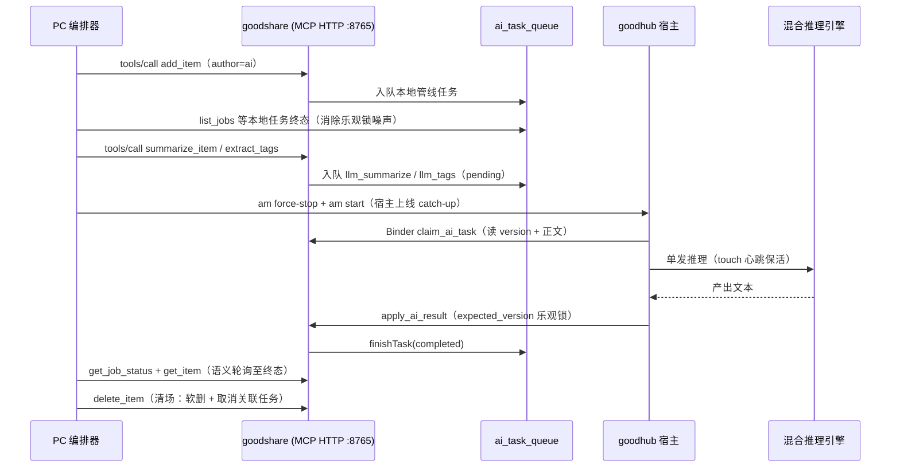

# 真机 AI 能力自动化验收（试点）

goodshare ↔ goodhub 跨 App AI 任务闭环的自动化验收层。首个落地场景是**摘要**（`llm_summarize`）与**分类/标签**（`llm_tags`），后续能力以声明式用例接入，不改编排器。

## 目标与边界

- **测生产链路**：PC 经 goodshare 的 loopback MCP 服务造条目并入队，goodhub 宿主上线后经 Binder 本地插件认领任务、调用 LLM 推理、`apply_ai_result` 回写，PC 再读回条目与任务终态断言。
- **不侵入业务**：不新增测试专用触发分支，不 mock 推理结果。消费触发复用生产语义「宿主上线 catch-up」（`TaskConsumeBootstrap.start()` 的 `loop.trigger()`），由 `am force-stop` + `am start` 驱动。
- **debug-only**：调试桥在 `!kReleaseMode` 装配，恒绑 loopback 并强制 Bearer；MCP 访问令牌只在运行时内存与 `/debug/state` 中存在，不落盘、不进报告与日志。
- **不假绿**：任一断言失败、超时、任务非 `completed` 均判 FAIL，并采集设备日志、宿主日志与整屏截图。金丝雀自测内含已知坏样本，证明断言「能抓到坏」。
- **归属原则**：`goodhub` 是通用推理与任务管线能力层，不为任何单个服务写适配代码；标签形态等领域校验归数据 owner `goodshare`，在 AI 结果回写动作层执行。

## 分层与落点

| 层 | 代码落点 | 职责 |
| --- | --- | --- |
| 设备可测性 | `lib/debug/debug_wiring.dart`、`lib/main.dart`、`lib/pages/mcp_page.dart` | 宿主专属端口、`/debug/state` 结构化快照（MCP 运行态 + 令牌）、MCP 页 `ValueKey` 锚点、桥启动容错 |
| 公共桥端点 | `app_debug_bridge`（同级独立包） | `/debug/state`、`/debug/logs`、`/debug/ui-tree`、`/debug/action`、`/debug/screenshot`；未注入端口回 501 |
| 薄管道 CLI | `scripts/agent-tools/debug-bridge.sh` | `discover` 按包名取端口/令牌、`adb forward`、端点原始 JSON 透传、`wait_log`/`system-ui`/`screenshot` 等设备侧命令 |
| 编排与断言 | `scripts/e2e/ai-capability-e2e.mjs` | 预检、声明式用例、语义等待、JSON 断言、清场、报告 |
| 工具壳 | `scripts/agent-tools/ai-e2e.sh` | 环境注入、`--json` 预检、`--self-test`、参数透传 |

复杂胶水不进工具脚本层：薄管道只调用原生命令并返回原始输出，用例编排与断言留在测试本体。

## 链路



## 端口与发现契约

| 端口 | 归属 | 用途 |
| --- | --- | --- |
| `8765` | goodshare MainActivity | loopback MCP HTTP，`x-api-key` 鉴权，PC 经 `adb forward` 接入 |
| `8767` | goodhub | 调试桥（公共包默认端口） |
| `8768` | goodshare | 调试桥（宿主装配期显式指定 `kGoodshareDebugBridgePort`） |

Android 的 loopback 地址空间由整机共享，两个接桥 App 同绑 `8767` 时后启动者必然失败。宿主在装配期分配互异端口，公共包把实际端口与令牌写进 logcat：

- `discover` 从 `adb logcat -d` 取 `[debug-bridge] listening on 127.0.0.1:<port> token=<token>`，按 `pidof <包名>` 的进程号过滤第 3/4 列，避免同机多 App 令牌串台；输出 `{package,port,token}`。
- 令牌每次启动轮换、只经 logcat 输出，logcat 环形缓冲被冲刷后启动行会消失。此时唯一可靠的恢复是**真正冷启动目标 App**（`am force-stop` + `am start`；App 已在前台时单独 `am start` 不会重跑入口、不会产出新行）。预检按此自愈并轮询 `/debug/action ping` 的 `contextReady` 等 UI 挂载。
- MCP 服务开关持久化，冷启动经 `restoreIfNeeded` 自动恢复；预检读 `/debug/state.app.mcpRunning`，关闭时经 MCP 页锚点打开并复查。
- `/debug/state.app` 提供 `mcpRunning` / `mcpPort` / `mcpEndpoint` / `mcpToken`。令牌的结构化可见性与「MCP 页点开令牌文本」等价，同样受 loopback + Bearer 约束；自动化据此避免依赖控件树在点显隐按钮后的重建时序。

## 用例与断言

用例是 `CASES` 中的声明：`{id, label, enqueueTool, action, seedTags, check, evidence}`。新增能力只加一条声明，编排器不改。

| 用例 | 入队工具 | 任务动作 | 专属断言 |
| --- | --- | --- | --- |
| `summary` | `summarize_item` | `llm_summarize` | `summary` 非空、非原文逐字、≥20 字、`summary_stale=false` |
| `tags` | `extract_tags` | `llm_tags` | 原有标签保留、有新增、新增 ≤12、每个标签 ≤24 字且不含 markdown/句子碎片 |

通用护栏（两例共用的 `commonProblems`）：任务 `found=true` 且 `status=completed`、动作与声明一致、原文 `text` 不被 AI 回写覆盖、`version` 递增。失败任务的 `note` 一并进报告。

- **语义等待**：按 `get_job_status(job_id)` 轮询至 `completed|failed|cancelled`；30s / 70s 仍在途时重驱动宿主上线（次数进报告），超时判 FAIL。
- **消除自身噪声**：`add_item` 会顺带入队本地管线任务；若它们未终态就入队远程任务，宿主 claim 读到的 `version` 会在推理期间被本地回写改掉，`apply` 撞 `version_conflict`。用例先按 `list_jobs` 等本条目本地任务 quiescent。
- **重复采样**：`--repeat <N>` 对每个能力独立造条目跑 N 轮，报告按 `byCase` 聚合 PASS 率。AI 产出有不确定性，单点通过不足以证明能力达标。
- **清场**：`delete_item` 软删测试条目并取消关联任务；`--keep` 保留现场。清场失败写入报告但不覆盖原始失败原因。

## 运行

```bash
toolbox run ai-e2e --json                                   # 环境预检结论（不跑用例）
toolbox run ai-e2e --device <SERIAL> --precheck            # 链路预检：双包/桥/MCP/令牌/initialize
toolbox run ai-e2e --device <SERIAL> --case all            # 摘要 + 分类
toolbox run ai-e2e --device <SERIAL> --case tags --repeat 3
toolbox run ai-e2e --device <SERIAL> --case summary --timeout 1   # 反向验证：超时必 FAIL
toolbox run ai-e2e --self-test                             # 断言金丝雀（不连设备）
```

前置：goodshare 与 goodhub 均为同签名 debug 包；goodhub 的 AI 引擎（BYOK 云端或端侧模型）就绪，否则任务会带 `note` 失败并被判 FAIL；设备 USB 在线。报告默认写 `build/e2e/ai-capability-report.json`，失败现场同目录（`*-device.log`、`*-host-logs.json`、`*-screen.png`）。

## 验收状态与落点归属

验收现状：`summary` 通过；`tags` 走双态断言——宿主产出合规则正常回写，产出不合规则被本仓护栏拒绝且失败可观测。真机重复采样 3/3 PASS（护栏生效），`--case all` 2/2 PASS。

**领域校验归数据 owner**：`goodhub` 是通用推理与任务管线能力层，不为任何单个服务写适配代码。标签形态校验落在 `goodshare` 的 AI 结果回写动作层：`lib/action/ai_tags_guard.dart` 的 `invalidAiTags()` 由 `ItemActionHandler._applyAiResult` 的标签并集路径调用，约束新增数量上限、单标签长度、markdown/句子碎片、原有标签保留；不合规即在 `_write` 之前整批拒绝（条目零变更），经 `ActionException` → `McpRpcError` → `finishTask('failed', note)` 给出含具体坏标签的可行动原因，严禁静默净化或记成成功。`HybridTaskInference` 的通用 prompt 与 `_mergeTags` 的通用切分保持不动（goodhub 仓零改动）。

| 缺口 | 归属 | 处置 |
| --- | --- | --- |
| 分类产出碎片标签 | goodshare（数据 owner，已落地） | `ai_tags_guard.dart` 整批拒绝 + `apply_ai_result` failed note 带具体坏标签；`test/ai_tags_guard_test.dart` 覆盖纯函数 / 动作层零写入 / MCP 可观测 / 合规路径回归；验收脚本双态断言（合规 completed、不合规护栏生效） |
| 乐观锁竞态：本地管线回写与 `apply_ai_result` 抢 `version`，冲突即任务 `failed` + `version_conflict` | 跨仓契约（现状记录） | 宿主 `apply` 遇冲突重读最新 `version` 重试一次，或入队时冻结版本语义；测试侧已先等本地任务终态，仅消除测试自身噪声 |
| 调试桥默认端口无多实例协商；goodhub 的 `stateProvider`/`resetHandler`/`screenshotProvider` 未注入，且 `trigger()` 无手动入口 | `app_debug_bridge` / goodhub 仓 | 公共包支持端口顺延并把实际端口自描述进 logcat；宿主补齐状态/截图注入与按需触发 action。当前以「宿主装配期分配互异端口 + CLI 按包名发现」和「宿主上线 catch-up」覆盖 |

标签的**格式约束**属于调用方的场景知识。若需要让模型产出结构化标签，由 `goodshare` 侧经通用载荷字段自带（跨仓契约另行评估），`goodhub` 不写服务专属分支；这与 [instant-ai-sampling.md](instant-ai-sampling.md) 的接入点边界（prompt 由调用方自带、host 只定义通用参数）同源，但落点仍在本仓。

## 扩展方式

- **加能力**：在 `CASES` 加一条声明（入队工具、任务动作、断言函数、证据字段），必要时补 `checkXxx` 纯函数与金丝雀样本。
- **加 App**：宿主注入自己的调试桥端口与 `stateProvider`，复用薄管道 CLI 的 `discover`，另写一份用例声明；公共包零改动。
- **加环境**：双包同签名、引擎就绪等前置尚未自动化预检时，在 `precheck()` 增加显式检查，禁止靠放宽断言让环境缺位「通过」。

## 决策日志

- 准入判 S2：摘要与分类共用同一套编排，否决一次性脚本，改「设备可测性 → 薄管道 CLI → 声明式用例」分层。
- 触发消费复用生产语义「宿主上线 catch-up」，不新增测试专用触发分支。
- 领域校验归数据 owner：goodhub 保持通用能力；标签形态校验落 goodshare 回写动作层，失败经 `last_note` 可观测。
- 状态观测走注入端口的结构化快照，不依赖控件树显隐；logcat 令牌发现失败靠真正冷启动自愈。
- 断言护栏与重复采样是验收手段，不是产出质量的替代品；不靠放宽断言拿绿。
- 回写是否发生以「入队后快照」为 `version` 基准：入队命令本身写 `is_processed=0` 会递增版本，拿造条目后的旧版本比较会误判护栏失效。
