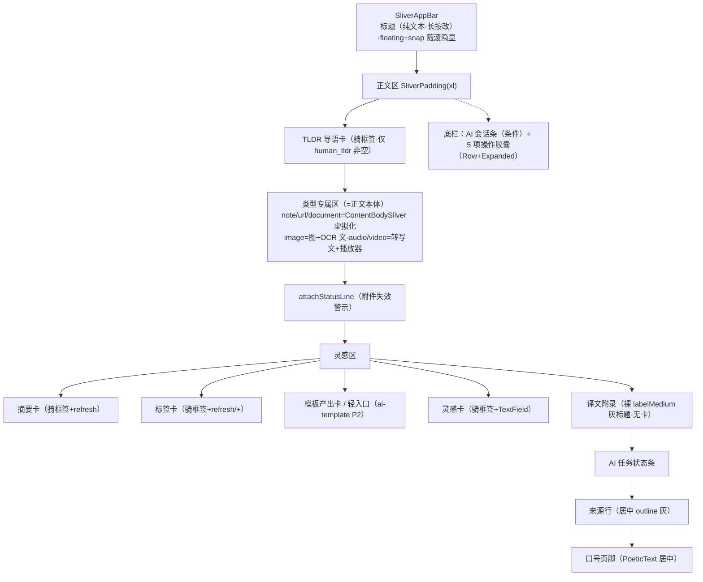

# 详情页视觉与人机交互对账蓝本

> 状态：**draft**——2026-10-15 首版对账 + 同日用户评审修订（v2：原建议自身次生问题修正 + 3 个盲点补入 + 核实结论）。**已拍板未实施**，拍板表见 §6。
> 对账基线：ui-spec §4.3、detail-two-zone.md、detail-visual-hierarchy.md、section_legend.dart（骑框签 SSOT）。
> 代码事实源：`lib/pages/item_detail_page.dart`、`lib/ui/item_view_template.dart`。

## 1. 范围与方法

- 范围：**详情页读态**（编辑态/三级能力页/浮层不在本期）。
- 方法：以现行 SSOT 为基准对账代码；v2 起每条结论必须附**代码核实结论**（成立/前提有误/部分成立），不允许「看着像」的建议进拍板表。
- 约束：不新造视觉语言——改动必须落在既有 token 体系、骑框签组件与 mymind 暗色三阶之内（ui-spec §2）。

## 2. 页面结构盘点（读态，现行代码）

> 结构勘误（v2）：正文与「类型专属区」是**同一物**——`ItemViewTemplate.bodySlivers` 只产 TLDR 卡 + 注册表视图（`item_view_template.dart:112`），不存在「正文之后另有类型专属区」的两段结构。

## 3. 优点（对账结论，保持）

- **文章形态成立**：标题置顶 AppBar、正文全宽、长文虚拟化、派生内容不抢正文。
- **骑框签分区语言**：TLDR/摘要/标签/灵感/模板产出五卡统一（`section_legend.dart` SSOT）。
- **chrome 纪律**：顶栏+底栏双隐显；编辑态底栏强制常驻（2026-10-02 高危缺口已堵）。
- **色彩纪律**：暗色三阶 + 单一橘红强调，无第二色彩系统。
- **图片条目已 media-first**（`:269-302` 图在上、OCR 文在下）——盲点 3 对图片的指控不成立（见 §5）。

## 4. v1 建议的次生问题修正（原建议撤回或改写）

| # | v1 原建议 | 核实结论 | v2 修正 |
|---|---|---|---|
| 1 | 译文附录「骑框签化」（P0-1） | **原建议错**。译文是全量正文镜像（translate 整篇 bodyText），可长达数千字；现行「文末 + 正文同款排版 + 无卡」恰是 content-pipeline §2.3 的正确口径，卡片化会造成「巨型卡片包万字」 | **撤回卡片化**。译文保持正文同款排版基线（全宽无框），仅轻量分隔标识；视态切换（原文/译文/双语）作为演进方向单独立项评估 |
| 2 | AI 任务状态条移至灵感区顶部（P0-2） | **原建议不充分**。AI 任务不止灵感区（翻译/OCR/重打标签/重解析，触发点在正文、类型工具、三级页），移哪都动线断裂 | **放弃全局条**：摘要/标签/模板的刷新态**内敛进卡内**（卡内 spinner/骨架）；全篇级任务（翻译/重解析）走 **AppBar 下方 2dp 线性进度**或底栏浮动小胶囊，长文任何滚动位置恒可见 |
| 3 | 灵感卡折叠为单行轻入口（P1-6） | **原建议有键盘陷阱**。CustomScrollView+SliverList 内点击展开 = 容器动态高度突变，叠加软键盘（侵占 40% 屏）无严格 `ensureVisible` 调度即抖动跳屏、光标被遮 | **改 BottomSheet 输入**：点轻入口呼出键盘跟随浮层，提交后回填卡片；禁止在长 Sliver 流内做原地动态形变 |

## 5. 盲点补入（v2 新增，全部附核实结论）

| # | 盲点 | 核实结论 | 方向 |
|---|---|---|---|
| A | **底栏 331dp 屏宽**：v1 仅列「真机验收」 | **前提有误、结论成立**。代码是 `Row`+5 个 `Expanded`（`:1597`），**不是 Wrap**——`:1528`「Wrap 而非 Row」是 `_actionBar` 文档注释的**孤儿残片**（其后两行实为 `_buildTitle` 的注释，两块被粘成一段），属注释漂移。真问题：5 格 × ~74dp 内容 > 331dp/5≈66dp → **横向溢出**（集成测试记录的 1.4px RenderFlex 溢出即此） | 强制单行；常驻裁剪到 **3 项**（编辑/分享/⋯ 或 AI 会话/编辑/分享），删除/工作区/机器码/保险箱全收 `⋯`；修注释漂移；`_barCell` 内容宽度入 token 核算 |
| B | **机器态层级过高**（P1-5 v1 建议加顶栏 chip） | **成立**。`_machineView` 在正文流内整块替换类型专属区（`item_view_template.dart:109-113`），无过渡；且为极低频调试特性（设置默认关） | v1 的 chip 建议**驳回**（挤占 331dp 标题空间）。机器态降级为**独立二级全屏页/抽屉**，读态容器保持纯粹；入口仍走 `⋯` |
| C | **媒体视线流倒置** | **部分成立**。图片条目已 media-first（图在上、OCR 在下，`:303-308`）——**图片指控不成立**；但 **audio/video 条目转写文本压在播放器之上**（`:324-328`、`:358-362`），1 小时音转写 45KB 文本会把播放器沉到底——**音频/视频指控成立**，且与图片口径自相矛盾 | 建立**类型前置判定**：audio/video 播放器前置至转写文本之上（与图片 media-first 对齐）；纯文本/文章类维持现状 |

## 6. 拍板表（2026-10-15 用户评审修订版，权威方向）

| 原问题 | 拍板决策 | 理由 |
|---|---|---|
| P0-1 译文卡 | **不叠骑框签**。文末正文同款排版 + 轻分隔标识；（原文/译文/双语视态切换另行立项） | 万字长文不进卡片，保沉浸阅读 |
| P0-2 状态条 | **放弃全局条**：卡内微观态（spinner/骨架）+ 全篇任务 AppBar 下 2dp 线性进度/底栏浮动胶囊 | 消除跨区跳转动线，长文恒可见 |
| P0-3 TLDR vs 摘要 | **收敛数据源**：`summary_md` 非空则折叠/不渲染 TLDR 卡，卡名统一定「摘要」 | 消除「被分析两次」心智负担。核实补丁：`human_tldr` 本机无写入方（仅 MCP `update_item(tldr)` 可写，管线自 LLM 迁出后不再产），折叠规则成本极低 |
| P2-7 底栏 | **消灭换行隐患、强制单行 3 胶囊 + `⋯` 溢出**（现行实为 Row 溢出，非 Wrap） | 堵死 331dp 极窄屏底栏吃屏高度/溢出的硬伤 |
| P1-5 机器态 | **降级为二级抽屉/独立页**，不加顶栏 chip | 极低频调试特性不污染阅读主容器 |
| P1-6 灵感卡 | **渐进披露改 BottomSheet 输入**，不做 Sliver 内原地形变 | 规避键盘+动态高度跳屏陷阱 |
| 盲点 C | **audio/video 播放器前置**（图片已正确，不动） | 媒体第一感知，口径统一 |

## 7. 实施顺序建议

1. **底栏单行化 + 注释漂移修复**（盲点 A）：✅ **已落地（2026-10-15）**——常驻裁 3 项（编辑/分享/⋯）；删除/工作区经 `ItemActions.overflowSheet` 移入 `⋯` 面板（删除首位红字 → 工作区 → 重新处理 → 权限开关组）；`:1528` 注释孤儿残片清理；ui-spec §4.3 / detail-two-zone.md §3 同步。真机验收项：底栏无 RenderFlex 溢出。
2. **TLDR/摘要收敛**（P0-3）：✅ **已落地（2026-10-15）**——`bodySlivers` 撤 TLDR 卡（`item_view_template.dart`，SectionLegendCard import 同步清理）；摘要卡回退链 = `summary_md` → 摄入期 `human_tldr` → 空态引导；ui-spec §4.3 文档形态 ② 标撤。
3. **卡内微观态 + AppBar 线性进度**（P0-2）：✅ **已落地（2026-10-15）**——`_activeActions` 任务态集（`_reload`/initState 两口刷新）；摘要/标签/模板卡 refresh 位进行中替换为 18px spinner；本条目有 active 任务时 Stack 顶层钉 2dp `LinearProgressIndicator`（不随 AppBar 隐显，长文任意位置恒可见）；全局状态条收敛为**仅终态**（失败/暂停/取消/完成无产出的 note，R1 保留），进行中行不再渲染（纯函数 `aiTaskStatusText` 契约不变，widget 层收敛）。
4. **audio/video 播放器前置**（盲点 C）：✅ **已落地（2026-10-15）**——`_audioView`/`_videoView` Column 子序调换（播放器在前、转写文随后）；核实：ui-spec §4.3 工具矩阵本就规定「播放器 → 转写文本」，代码此前漂移，本次为对齐规范。
5. **机器态降级二级页**（P1-5）：✅ **已落地（2026-10-15）**——新建 `lib/ui/machine_view_page.dart`（JSON 全屏页 + 「暂无机器态」空态）；`ItemViewTemplate` 撤 `machineMode` 参数与 `_machineView`；`ItemActions.machineMode` 改导航入口（撤勾选态）；`ItemActionContext.machineMode` 字段移除（唯一构造点同步）；`⋯` 面板动作改名「机器态」。ui-spec 三处陈述同步。
6. **灵感卡 BottomSheet 化**（P1-6）：✅ **已落地（2026-10-15）**——Sliver 内 TextField 撤除（`_inspirationCtrl`/`_saveInspiration` 失焦即存/dispose 兜底全退场）；灵感卡改展示态（有内容=文本+编辑图标；空态=一行轻入口）；`_InspirationSheet` 键盘跟随浮层（显式保存/取消，未改动跳过写入不空耗乐观锁）。
7. **译文轻分隔标识**（P0-1 残余）：✅ **已落地（2026-10-15）**——`_appendix` 加 `outlineVariant` Divider + 顶部间距 `Insets.xxl`（替换 24px 魔法数批次的一部分）；视态切换（原文/译文/双语）另行立项。

## 8. 验证口径

- `flutter analyze` 0 issue / 全量测试绿；骑框签组件复用（禁手写边框+小签对）。
- 底栏：331dp 逻辑屏无 RenderFlex 溢出（集成测试现有 1.4px 溢出过滤随本轮消除）。
- 真机侧载验收：长文任意滚动位置任务进度恒可见（P0-2）、音/视频条目播放器首屏可见（盲点 C）、灵感 BottomSheet 键盘不跳屏（P1-6）。
