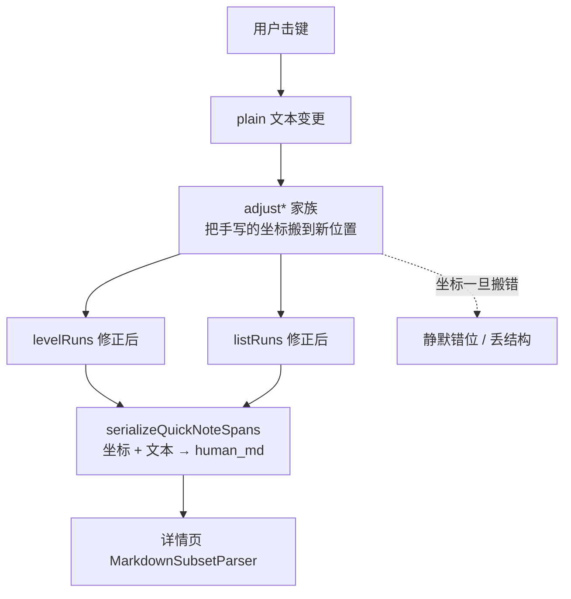
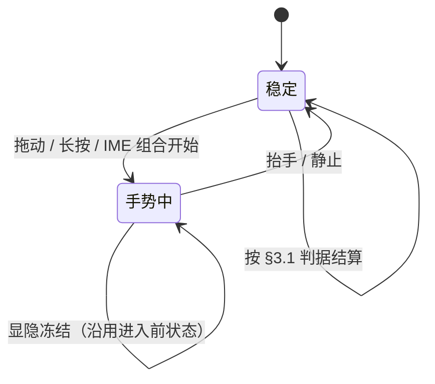
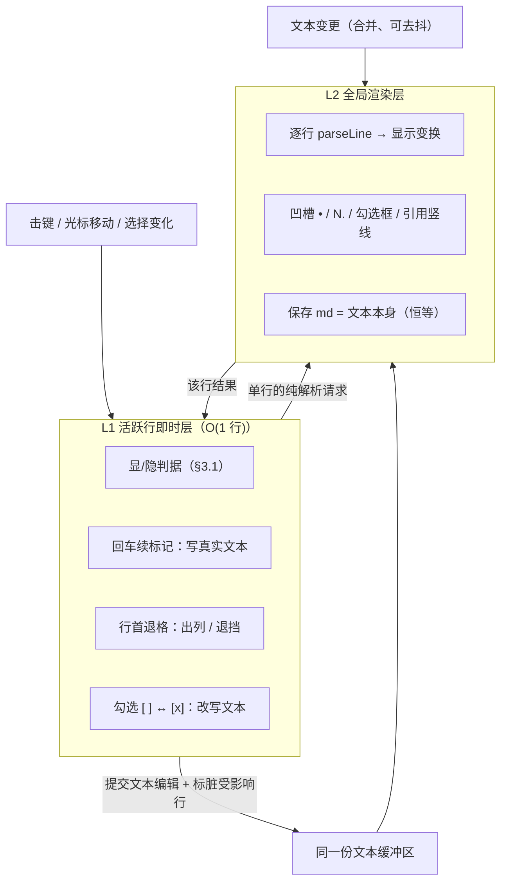

# 速记行级结构：从「文本 + 坐标」双真相迁移到单一真相源

> 2026-10-07 用户拍板「继续推进的话就是补丁落补丁了，我想先从底层把这个问题解决掉」，
> 并确认采用**标记显隐策略 B**（光标进入标记区时显原文、其余行所见即所得）。
> 本文只记录**根因、目标模型、显隐策略、分层机制、风险与迁移阶段**——
> 交互 SSOT 见 [quick-note-format-dial.md](quick-note-format-dial.md)，编辑器统一见
> [note-editor-unification.md](note-editor-unification.md)，GFM 语法契约见
> [rich-text-gfm.md](rich-text-gfm.md)。

## 1. 根因诊断

### 1.1 现状模型：两个真相源靠手写同步

`lib/share/quick_note_span_codec.dart` 的 `QuickNoteSpans` 由四部分组成：

| 维度 | 内容 | 真相性质 |
|---|---|---|
| `plain` | 编辑区唯一文本（已剥 md 标记） | **源**（用户可见） |
| `runs` | 字符级行内样式（粗/斜/下划线） | 派生 + 存坐标 |
| `levelRuns` | 行级标题档位坐标 `[start,end)` | 派生 + 存坐标 |
| `listRuns` | 行级列表身份坐标 `[start,end)` | 派生 + 存坐标 |



### 1.2 三条实证：这个范式会持续产出 bug

同一类「坐标正确性的手工维护」已经交付了三个实例：

1. **空占位 run 蒸发**——`adjustQuickNoteListRuns` 的「窗吞掉整行 → 身份消亡」分支，
   会让刚出现空列表项在敲下第一个字时被删除。
2. **diff 对齐二义性**——`spanChangeRange` 对「在 `\n` 相邻处插 `\n`」可对齐到行首或行尾
   两个等价位置；判成「变更在本行之后」时老 run 不收尾，多行列表项的续行沦为孤儿正文。
3. **双份实现漂移**——上述第 1 条在 `levelRuns` 侧同样存在（空标题行敲首字丢档位，
   与 `setQuickNoteLevel` 注释声明的意图相悖），却长期无人发现。**同一段坐标数学写在两处，
   修一处不会自动同步另一处。**

另外，行维度的形状本身也不成立：`levelRuns` 与 `listRuns` 是两条**平行列表**，类型层面
无法表达「一行只有一种身份」，于是互斥只能靠注释声明（`rich_text.dart` 的
「标题与列表互斥（标题优先）」），实际由 `serializeQuickNoteSpans` 写死优先级仲裁。

### 1.3 更深的根：模型是从「展示」反推长出来的

`listRuns` 最初**只能**由 `seedQuickNote`（草稿恢复/导入 md）与 `insertSeededSpans`（粘贴）
产生，逐字输入路径 `_onSegChanged → applyQuickNoteSpansInput → adjustQuickNoteListRuns`
只搬移既有 run、从不新建。也就是说：**列表当初只为「粘贴/导入 md → 渲染」服务，
输入端是后来 Retrofit 的。**

这解释了最初提出的用户问题（「输入之后的困惑 / 因为技术方式的无奈妥协」）——不是某个
函数的 bug，而是模型的成长方向错了：先有读，再有写。（截至 2026-10-07，输入端已按旧
范式补落两枚 retrofit——`convertQuickNoteLineMarker` / `extendQuickNoteContinuation`，
恰是「补丁落补丁」的实证；S3 将连同坐标同步层一并退役，见 §6。）

### 1.4 沉淀出的规则

- **第二次复制同一段逻辑前必须先抽象。** 当你自己的注释写出「同款」二字
  （`adjustQuickNoteListRuns` 的注释原文），那就是抽象扳机。
- **把 `note-editor-unification.md` §2 的「字面文本保留」裁决视为症状。** 「段模型不认识的
  旧结构（列表/引用/代码块/分隔线）在编辑态以字面 md 呈现」——这条妥协在目标模型下应消失。

## 2. 目标模型：文本即真相源

### 2.1 形状

编辑器的文本**就是 md 本身**（含 `- ` / `# ` / `> ` / `[ ]` / ``` 等标记）。行结构不再存储，
而是由单行解析**实时推导**；`plain` 之外的**线级**派生数组（`levelRuns` / `listRuns`）
全部退役；字符级 `runs` 是否同轮并入文本真相属 S3 范围裁决（§8 未决，建议留后续）。

### 2.2 消失的与新生的事物

**消失**（净删数百行）：

| 退役区块 | 原因 |
|---|---|
| `seedQuickNote` | 无需「剥标记 → 无标记态」的转换入口 |
| `adjustQuickNoteLevelRuns` / `adjustQuickNoteListRuns` | 坐标随动失去对象 |
| `splitQuickNoteSpansAt` / `mergeQuickNoteSpansInto` | 同上 |
| `insertSeededSpans` | 粘贴即原文本，无需坐标合并 |
| `convertQuickNoteLineMarker` / `extendQuickNoteContinuation` | 标记本就写在文本里 |
| `serializeQuickNoteSpans` | 序列化退化为恒等函数 |

**新生**：`parseLine(line) → LineShape{种类, 标记区末端, 正文起点, …}`（纯函数、O(行长)），
以及把推导结果落成可见样式的显示变换（§4）。

**用户可见功能不减**：`- ` 落定为列表项、裸 `[ ]` 待办、续行归并、回车续新项、
有序自动重排——在新模型下依然存在，只是实现从「维护坐标」变为「文本本就带标记」
（自动重排的归属裁决见 §2.4）。

### 2.3 确认：持久化格式零迁移

`noteSegsToDraftRows` 导出的**本来就是 md**（`serializeQuickNoteSpans` 的产物），
媒体段走 `['i'|'a'|'v', url, label?]` 不受影响。新模型下文本即 md，落盘字节一致
——**不存在新旧草稿兼容问题，不需要任何数据迁移**。风险边界被限制在编辑期。
（该等价性对**存量草稿**逐字节成立；对新输入允许 §2.4 的有序序号规整差异。）

### 2.4 有序列表「自动重排」的归属（L2 推导，不进 buffer）

§2.2 承诺「有序自动重排」在文本模型下依然存在，但它与 §4.2「L1 禁全篇遍历」存在
表观冲突——序号在新模型里是文本中的字面数字，而重排天然涉及整组有序项。裁决如下：

- **显示序号 = L2 渲染期推导，绝不回写 buffer。** L2 逐行渲染时对连续有序组
  （沿用 `quickNoteOrderedOrdinals` 的「同组递增、非有序断组归零」口径）重新编号
  展示；buffer 里的字面数字保持用户所写。用户输入 `2. foo` 就存 `2. foo`，
  屏幕上显示 `1. foo`（若它是一组的开头）——与凹槽 bullet 同属「显示变换」，
  不触碰 L1 的单行作用域契约。
- **落盘规整 = 序列化期一次性清洗。** 保存路径（`toNoteSegments → serializeNoteMd`）
  与编辑路径是两个出口；落盘时对有序组输出**重算后的规范序号**（沿用今日
  `serializeQuickNoteSpans` 的既有行为，存量草稿字节不变）。即「屏幕所见」与
  「落盘所得」在有序组序号上允许差异，这是 md 有序列表「序号即建议」的标准语义。
- **用户改序号的出口**：光标进入该行标记区（§3.1 判据）即见字面序号，可直接编辑
  ——「所见即所存」只对标记区成立，与列表标记的显隐口径自洽。

## 3. 显隐策略：唯一会被用户感知的行为变化

### 3.1 判据

不采用「整行跟随光标」的朴素版（会导致闪烁），采用**前缀邻近 + 稳定态结算**判据：

```
reveal(行, 光标) = 光标在该行内
                 ∧ (标记区之后无正文 ∨ 光标 ≤ 该行标记区末端)
                 ∧ 非「冻结中」        // 见 §3.2
```

- **为空必显**：空列表项在文本里就是 `- `（标记区之后无正文），若隐藏则成为
  「看不见、点不到、删不掉」的陷阱。
- **走入标记区必显**：这正是用户要编辑/删除标记的时刻。

### 3.2 稳定态结算原则（滞后）

> **显隐变更只在稳定态结算——连续手势（拖动选择、长按退格、IME 组合）期间冻结，
> 抬手 / 静止后再结算。**

这条必须抢在 §4 之前写死：否则后面每个交互都会各歪一次。



### 3.3 逐场景推演

| 场景 | 行为 |
|---|---|
| 光标在行尾正常打字 | **不显**（全文 WYSIWYG） |
| 光标走到行首 / 标记区内 | **显**（可编辑 `- ` / `# `） |
| 光标进入空列表项行 | **显**（防不可见陷阱） |
| 从第 N 行行首回删，并入第 N-1 行 | 光标落在 N-1 行内容末尾 → **N-1 不显** |
| 连按退格连续穿越数行 | 每次进入的行光标都在行尾 → **全程不闪**，且处于冻结态 |
| 一直退到第 N-1 行标记区 | **显**（此时用户正要动它） |
| 拖选跨行选中 | 选中期间**冻结**，抬手后按判据结算 |

## 4. 两层机制

### 4.1 分层



### 4.2 L1 活跃行即时层

- **范围**：仅光标所在的那一行；**不含**任何全篇遍历。
- **触发**：按键、光标移动、选择变化（同步）。
- **职责**：§3.1 判据、以及必须「即时手感」的结构动作——这些动作一律**写真实文本**
  （回车插入下一枚标记、行首退格删标记出列、勾选翻转改写 `[ ]`/`[x]`）。
- **产物**：`LinePatch{行 index, 该行 display spans, 选择区修正, 可选文本编辑}`。

### 4.3 L2 全局渲染层

- **范围**：整段文本。
- **触发**：文本标脏后（可去抖/合并多帧）。
- **职责**：逐行 `parseLine` → 显示变换；凹槽标记；「保存」退化为恒等。

### 4.4 四条契约（两层的联系）

1. **唯一真相 = 文本。** 两层都只读同一份字符串——**没有坐标清单需要同步**，
   §1 的 bug 类从根上消失。
2. **L1 → L2**：L1 一旦改写文本，立即把受影响行标脏；L2 只重算脏行 + L1 请求的那一行。
3. **L2 → L1**：L1 **绝不等待** L2 完成全篇——只索取「当前这一行的单次纯解析」，
   命中同一份 `parseLine` 原语。
4. **光标归 L1 / 编辑器独占**：L2 只负责画，不改选择区，避免两层互相打架。
5. **显隐 = 纯谓词 + 有界 latch，两者分离**：
   - **谓词 `reveal(文本, 光标)`**（§3.1）是纯函数，paint 时求值，禁跨帧缓存。
   - **冻结 latch**（§3.2「手势中沿用进入前状态」）是有状态的，**唯一归属 L1**——
     一个手势进行中布尔 + 显隐结算只在稳定态写入；L2/渲染层对 latch 无感知，
     只拿到谓词的当帧求值结果。
   - 契约 1（唯一真相 = 文本）不受侵蚀：latch 只门控「哪一帧用哪个谓词输入」，
     不派生不存储第二份文本态；手势结束 latch 复位，谓词照常重算。

### 4.5 标记区显隐：buffer ↔ display 的偏移问题（唯一映射点）

隐藏标记意味着同一行存在两种形状：**buffer**（真实文本，含 `- ` 等标记）与
**display**（正常态所见，标记不可见）。若不钉死规则，这里会悄悄长出第二套坐标
同步——正是本文要消灭的东西。裁决：**全编辑器只认 buffer 一个坐标系，不做双坐标
换算**，代价收敛为一个 O(1) 的单行钳制：

1. **隐藏态渲染**：标记区字符在 `buildTextSpan` 中零宽渲染（显示变换的一部分，
   归 L2）；buffer offset 不因此增删。
2. **caret 几何由判据自保证**：§3.1 的结构使「光标落在标记区内 ⟺ 该行处于显态」
   ——显态下标记正常渲染，几何天然正确；隐藏态下光标必然在正文区（> 标记区末端），
   零宽隐藏不扭曲 caret。**不存在「光标悬在不可见字符上」的第三态。**
3. **IME 组合**：组合文字只发生在光标处；光标在正文区（隐藏态）时组合 region
   直接以 buffer offset 表达，无需换算。光标进入标记区即转显态，同样无需换算。
4. **选择区钳制（唯一映射点）**：拖选/全选的端点可能扫过标记区——display 端点
   按单行钳制 `offset = max(offset, bodyStart)` 吸附到正文起点（选中是否包含标记
   由判据显态决定）。这是一次 O(1) 纯函数钳制，**不是**可漂移的坐标清单。
5. **占宽隐藏（已落地，2026-10-08 回写）**：标记区隐藏态采用「**占宽隐藏**」——
   纯透明渲染（`Color(0x00000000)`）但保留字符宽度（span_text_controller.dart 的
   `_markerHiddenTag` 分支，S1 即取此方案），判据不变、仅显示变换调整。取舍：规避零宽
   span 在部分厂商 IME（不按 unicode 剔除退格的输入法）组合期退格的吞字/双删风险，
   代价是标记区占位使列表项/标题正文比无标记段落多缩进一个标记宽度（即 B1「占宽缩进
   参差」——已知取舍，IME 安全优先，devlog 2026-10-07 拍板）。零宽版若未来真机验证
   IME 无碍可再评估，但不作为默认。

### 4.6 显式不做的事

- **v1 不做行级缓存。** 单行 parse 是 O(行长)，肉眼不可察；引入缓存等于把「简单」
  换回「复杂」。真到性能瓶颈再上。
- **禁止第二条解析路径。** L1 与 L2 必须共用 `parseLine`——否则会重演 §1.2 第 3 条的漂移。

## 5. 风险与对策

### 5.1 来自目标模型（B 组）

| ID | 风险 | 是否由分层解决 | 对策 |
|---|---|---|---|
| B-1 | 编辑时看到原始标记（观感倒退） | ⚠️ 仅收窄 | §3.1 判据 + §3.2 滞后；残留需真机 dogfood 验收 |
| B-2 | 隐藏字符导致光标几何不可靠 | ✅ 基本解决 | 全编辑器只认 buffer 坐标系，不做双坐标换算；caret 几何由 §3.1 判据自保证，选择区端点做 O(1) 钳制（机制见 §4.5）；零宽 span 在厂商 IME 下的退格残留需真机验证 |
| B-3 | IME 组合期 | ❌ 未自动解决 | 纳入 §3.2 冻结场景（沿用现有组字期守卫做法） |
| B-4 | 迁移面大、既有功能回归 | ❌ 加剧 | §6 分阶段；S0–S2 只加不改 |
| B-5 | 加一种语法仍然昂贵 | ✅ 结构性解决 | 需 S3 落定后兑现 |

### 5.2 来自分层机制（N 组）

| ID | 风险 | 对策 |
|---|---|---|
| N-1 | 显隐成为新的派生状态，易错帧 | 契约 5：谓词纯函数、paint 时求值、禁跨帧缓存；冻结 latch 有界且唯一归 L1（§4.4） |
| N-2 | 快慢两条解析路径漂移 | 强制共用 `parseLine`（S0 的意义，不可省略） |
| N-3 | 提交顺序文本 → 失效 → 选择区错乱 | 单一提交顺序；先例见 `note_composer_editor.dart` 的顺序红线注释 |
| N-4 | 过早引入缓存 | v1 不做（§4.6） |
| N-5 | 手势期闪烁 | §3.2 稳定态结算（与「回删不露」统一为一机制） |
| N-6 | **测试覆盖断档**：现有 716 项保护的是旧模型 | S0–S2 只增新测试、不动旧断言；替换只发生在 S3 |

### 5.3 最大风险排序

1. **N-6 覆盖断档**——技术债不是不还会消失，只是推迟。
2. **B-1 观感变化**——只有真机试用才算数，需用户亲自验收。
3. N-1 / N-3 的时序一致性。

## 6. 迁移阶段

每阶段独立可绿；**S3 是唯一不可逆的范式切换**。

| 阶段 | 入口 | 产出 | 验收 | 回滚 |
|---|---|---|---|---|
| **S0** | 抽出单行纯解析原语 | `parseLine(line) → LineShape` + 单测 | 覆盖其抽出=false 语法格里现有正则同口径；零行为变更 | 删文件 |
| **S1** | 显示变换落到 `buildTextSpan` | 按 §3.1 判据显隐标记 | §3.3 全场景表；旧渲染路径仍在线 | 开关切回 |
| **S2** | L1 三个结构动作改为写真实文本 | 回车续标记 / 行首退格 / 勾选翻转 | 与今日行为等价 + 真机 dogfood | 开关切回 |
| **S3** | `QuickNoteSpans` 切到文本真相 | 删除同步层（净删数百行） | §7 验收基线；持久化字节 diff 为空 | 仅在 S3 前保留分支 |
| **S4** | 引用 / 代码块 | 新增一种 kind | 与详情页 parser 往返一致 | 独立可逆 |

**门禁**：S3 之前必须在真机 dogfood 一两天。宁可停在 S2，也不要带不确定冲 S3。

## 7. 验收基线（把今天的坑变成可回归的断言）

1. **回删跨行不露**：第 N 行行首连按退格穿越第 N-1 行，第 N-1 行保持所见即所得。
2. **手势期冻结**：拖动选择 / 长按退格 / IME 组合期间，显隐状态不随每帧变化。
3. **显隐 = 纯谓词 + 有界 latch**：同一 `(文本, 光标)` 两次谓词求值结果一致；
   可变状态仅限契约 5 的 L1 冻结 latch，且手势结束即复位。
4. **空活跃行必显**：光标进入空列表项行必须显示 `- `，防不可见陷阱。
5. **持久化等价**：对既有存量草稿快照，新模型落盘 md 与旧 `serializeQuickNoteSpans`
   输出逐字节一致（新输入的有序序号规整差异按 §2.4 口径豁免）。
6. **往返一致**：新模型文本经 `MarkdownSubsetParser` 解析后渲染等价（沿用既有红线）。
7. **孤儿续行回归**：多行列表项首行回车，续行不沦为正文（对应 §1.2 第 2 条）。

## 8. 未决问题

- **S3 的替换范围**：`levelRuns` 侧的「先选后打」inline mark 是否同轮并入文本真相
  （并入则 `runs` 也退役，收益最大但改动最大）。建议 S3 先只切线级，inline 留后续。
- **是否需要 modest 缓存**：待 S4 后按实测决定，不在 v1 预设。
- **移动端 IME 适配**：不同输入法组合期表现需在真机逐一确认。
